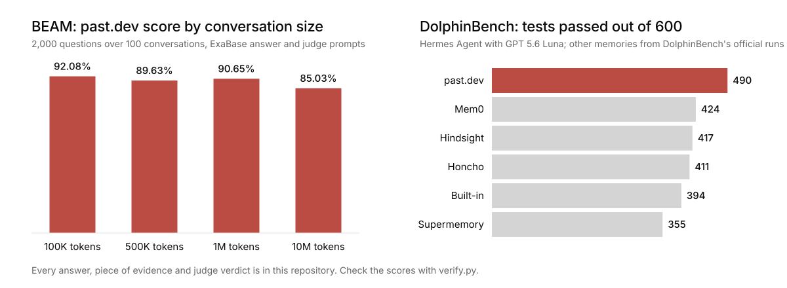

# past.dev benchmarks

Agent memory benchmarks you can check yourself. This repository holds the harnesses behind the
results on [past.dev/benchmarks](https://past.dev/benchmarks), and every answer, piece of evidence
and judge verdict from the published runs. They use only past.dev's public API, the same calls you
would make to add memory to your own product.

<p align="center"></p>

| Folder | Benchmark |
|---|---|
| [`beam/`](beam) | [BEAM](https://arxiv.org/abs/2510.27246), long-conversation memory at 100K, 500K, 1M and 10M tokens |
| [`dolphin/`](dolphin) | [DolphinBench](https://github.com/mem0ai/dolphinbench), Mem0's agent-memory benchmark: 600 tests over three users' histories, graded on the agent's app calls |

## Check the numbers without an account

`verify.py` recomputes every BEAM score and the summary from the saved judge verdicts. It calls no
memory API and no model, so it needs no key.

```bash
git clone https://github.com/pastdotdev/benchmarks.git
cd benchmarks/beam
pip install -r requirements.txt
python verify.py results/100k        # or results/500k, results/1m, results/10m
python verify.py --prompts           # our prompts match ExaBase's published file
```

The first command downloads the public BEAM dataset once, to confirm that every question has one
record.

## Run it yourself

To run a benchmark again, you need a past.dev account ([sign up](https://sso.past.dev/sign-up)), its
organization key, and an [OpenRouter](https://openrouter.ai) key. Each conversation gets its own
project, and a new account allows fewer projects than a full split needs; the folder's README says
how to run within that.

## Run BEAM on another memory system

The BEAM harness reaches past.dev only through [`beam/past_api.py`](beam/past_api.py). To run it on
another memory system, replace that class with one that sets up a store for each conversation,
ingests the turns and answers a recall. The dataset, the answer and judge prompts and the scoring
stay as they are, so the scores compare. If you publish a port and its results, open an issue and we
will link it here.

## BEAM results

The saved baseline covers all 100 conversations and 2,000 questions. The combined score,
weighted by question count, is **90.02%**.

| Split | Conversations | Questions | Score | Files |
|---|---:|---:|---:|---|
| 100K | 20 | 400 | **92.08%** | [Summary](beam/results/100k/summary.json) · [Results](beam/results/100k/results.jsonl) |
| 500K | 35 | 700 | **89.63%** | [Summary](beam/results/500k/summary.json) · [Results](beam/results/500k/results.jsonl) |
| 1M | 35 | 700 | **90.65%** | [Summary](beam/results/1m/summary.json) · [Results](beam/results/1m/results.jsonl) |
| 10M | 10 | 200 | **85.03%** | [Summary](beam/results/10m/summary.json) · [Results](beam/results/10m/results.jsonl) |

See the [BEAM README](beam/README.md#results) for the category breakdown and instructions
for verifying the saved results or running the benchmark.

## DolphinBench results

Hermes Agent with GPT 5.6 Luna and past.dev as its memory passed **490 of 600** DolphinBench tests.
In DolphinBench's official runs of the same agent and model, the other memories pass 355 to 424.

| Memory | Passed | Morgan | Alex | Riley | Cost | Median latency | Files |
|---|---:|---:|---:|---:|---:|---:|---|
| **past.dev** | **490 / 600** | 173 | 148 | 169 | $196.72 | 51.6 s | [Run](dolphin/results/hermes-gpt-5.6-luna/) |
| Mem0 | 424 / 600 | 156 | 132 | 136 | $96.21 | 37.7 s | [Official](https://github.com/mem0ai/dolphinbench/tree/81cb6f8405b40a9e76089cef650806a80af06ea2/results/hermes/gpt-5.6-luna/mem0) |
| Hindsight | 417 / 600 | 144 | 127 | 146 | $84.65 | 55.3 s | [Official](https://github.com/mem0ai/dolphinbench/tree/81cb6f8405b40a9e76089cef650806a80af06ea2/results/hermes/gpt-5.6-luna/hindsight) |
| Honcho | 411 / 600 | 144 | 120 | 147 | $142.85 | 44.7 s | [Official](https://github.com/mem0ai/dolphinbench/tree/81cb6f8405b40a9e76089cef650806a80af06ea2/results/hermes/gpt-5.6-luna/honcho) |
| Built-in | 394 / 600 | 131 | 111 | 152 | $61.48 | 44.4 s | [Official](https://github.com/mem0ai/dolphinbench/tree/81cb6f8405b40a9e76089cef650806a80af06ea2/results/hermes/gpt-5.6-luna/builtin) |
| Supermemory | 355 / 600 | 138 | 98 | 119 | $345.64 | 52.7 s | [Official](https://github.com/mem0ai/dolphinbench/tree/81cb6f8405b40a9e76089cef650806a80af06ea2/results/hermes/gpt-5.6-luna/supermemory) |

past.dev's own minimal agent, a separate configuration with the same model, passed 520 of 600 for
$15.77. See the [DolphinBench README](dolphin/README.md#results) for the split by task kind, every
way the run differs from the official ones, and how to check or rerun it.

## License

The code is MIT licensed ([LICENSE](LICENSE)). Benchmarks, datasets and third-party prompts keep
their own terms, credited in each folder's `NOTICE.md`.
